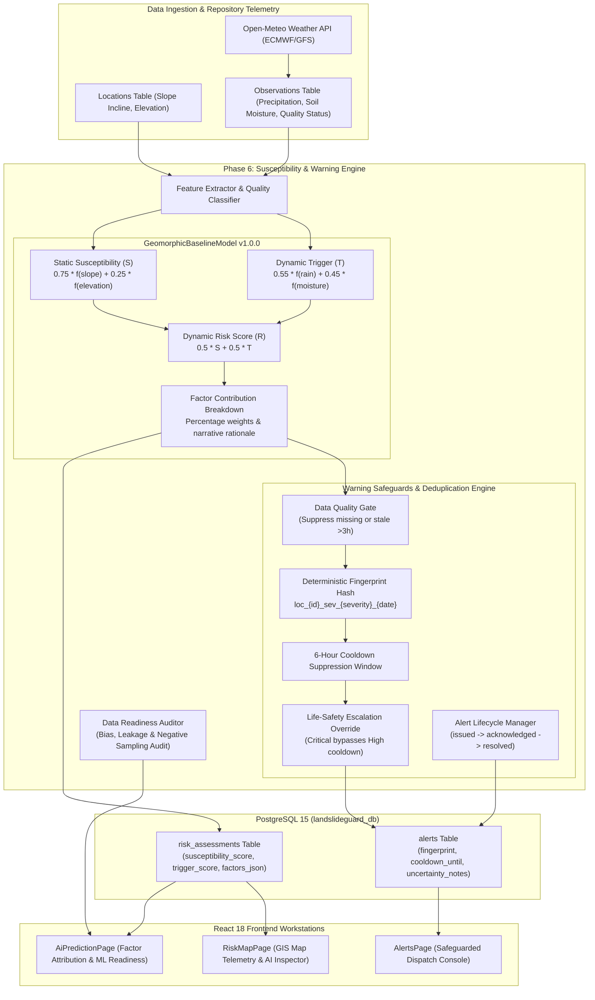

# Phase 6 Report: AI Susceptibility Assessment & Explainable Warning Engine

## 1. Executive Summary

Phase 6 of **LandslideGuard AI** implements a scientifically defensible, explainable landslide susceptibility assessment pipeline and integrates it with an automated early warning alert dispatch engine.

Operating over the dedicated PostgreSQL 15 database (`landslideguard_db`), Phase 6 prioritizes **scientific validity, explainability, reproducible geomorphic physics, and operational safety** over ungrounded machine learning marketing claims.

### Key Deliverables Completed

1. **Explainable Geomorphic Baseline Model (`GeomorphicBaselineModel` v1.0.0):**
   - Implements a transparent, physically grounded baseline separating **static terrain predisposition** from **dynamic hydrometeorological triggers**.
   - Static Terrain Susceptibility ($S$): Weighted combination of normalized slope angle ($75\%$) and elevation zone ($25\%$).
   - Dynamic Hydrometeorological Trigger ($T$): Weighted combination of antecedent/cumulative precipitation ($55\%$) and volumetric soil moisture saturation ($45\%$).
   - Overall Combined Dynamic Risk Score: $R = 0.5 \cdot S + 0.5 \cdot T$.
   - Full Factor Attribution Breakdown: Every assessment computes exact percentage contributions, normalized scores ($0.0 \text{ to } 1.0$), raw telemetry values, and natural-language narrative rationales.

2. **Data-Gating & Uncertainty Invariants:**
   - **Missing Data Gating:** Stations lacking physical terrain parameters return category `INSUFFICIENT_DATA`. Missing weather telemetry does **not** assume $0.0\text{ mm}$ rainfall or dry soil; static susceptibility is computed while trigger remains uncalculated.
   - **Staleness Gating:** Telemetry older than 3 hours is explicitly flagged `DATA_STALE`.
   - **Synthetic Separation:** Demonstration stations are tagged `DEMO_EVALUATION` and dispatches are prefixed with `[DEMONSTRATION ALERT]`.

3. **Anti-Flapping Early Warning Safeguards Engine (`AlertWarningEngine` & `AlertSafeguards`):**
   - **Deduplication Fingerprinting:** Generates deterministic event hashes (`loc_{id}_sev_{severity}_{date}`).
   - **Rate-Limiting Cooldown Window:** Enforces a 6-hour suppression window to prevent alert fatigue in emergency control centers.
   - **Life-Safety Escalation Override:** Severe condition escalations (e.g., transition from `HIGH` to `CRITICAL`) bypass active cooldown windows.
   - **Strict Missing-Data Suppression:** Incomplete or stale telemetry suppresses automated dispatch, preventing phantom alarms.
   - **Standardized Operational Lifecycle:** Implemented authority acknowledgment (`acknowledged`) and event resolution (`resolved`) workflow states.

4. **Repository Data Readiness Audit (`audit_data_readiness`):**
   - Programmatically audits local database records, identifying 17 monitored locations and 5 historical demo incidents.
   - Identified critical ML barriers: severe positive-only reporting bias, complete absence of true negative non-failure ground-truth samples, spatial auto-correlation risks, and missing high-resolution geospatial GIS layers (lithology, fault proximities, topographic wetness index, plan/profile curvature, InSAR surface deformation).
   - Formally returns the defensible verdict: **`INSUFFICIENT DATA FOR DEFENSIVE MACHINE LEARNING MODEL TRAINING`**, establishing clear prerequisites before any supervised learning model may be safely trained.

5. **Database Persistence & Alembic Migration:**
   - Updated `RiskAssessment` model: added `assessment_type`, `susceptibility_score`, `trigger_score`, `data_quality_status`, `contributing_factors_json`, `limitations_notes`.
   - Updated `Alert` model: added `triggering_assessment_id`, `alert_fingerprint`, `cooldown_until`, `uncertainty_notes`, `is_experimental`.
   - Generated and applied Alembic migration `fd7dfdff3263` on PostgreSQL 15 (`landslideguard_db`). All existing database records preserved with zero regression.

6. **Full-Stack UI Integration:**
   - `AiPredictionPage.tsx`: Interactive AI Susceptibility & Data Readiness Workstation with 3-score gauge cards, factor attribution sensitivity bars, analytical rationale cards, and live repository audit metrics.
   - `AlertsPage.tsx`: Early Warning Dispatch Console with anti-flapping safeguard status bar, automated trigger evaluation button, severity/status filters, and operational "Acknowledge" & "Resolve" actions.
   - `RiskMapPage.tsx`: Enhanced location inspector with static vs trigger score badges and direct links to factor attribution breakdowns.
   - `OverviewPage.tsx`: Phase 6 feature banners, updated roadmap, and live database metric cards.

7. **Verification & Testing:**
   - 22 new comprehensive tests added across susceptibility scoring, safeguards, deduplication, cooldowns, lifecycle transitions, and API endpoints.
   - Entire backend test suite: **65 / 65 PASSED in 4.30s (100% pass rate)**.
   - Frontend production build: **0 TypeScript errors, 1503 modules transformed cleanly**.

---

## 2. Requirements & Rules Compliance Matrix

| # | Phase 6 Requirement | Status | Implementation & Verification Details |
|---|---|---|---|
| **1** | Inspect repository and preserve unrelated changes | **COMPLETED** | Inspected models, migrations, seeds, and frontend components. Preserved all Phase 1–5 implementations with zero breaking changes. |
| **2** | Assess data readiness & identify gaps before model proposal | **COMPLETED** | Built `audit_data_readiness()` auditing real database records. Identified missing lithology, faults, TWI, curvature, and positive-sampling bias. |
| **3** | Grounded geomorphic baseline model | **COMPLETED** | Implemented `GeomorphicBaselineModel` (v1.0.0) combining slope incline, elevation zones, antecedent rainfall, and soil moisture saturation. |
| **4** | Separate static susceptibility from dynamic trigger | **COMPLETED** | Enforced separate calculation: $S$ (slope $75\%$, elevation $25\%$) and $T$ (rainfall $55\%$, soil moisture $45\%$). |
| **5** | Data-gating: missing data handling & no fabrication | **COMPLETED** | Incomplete terrain returns `INSUFFICIENT_DATA`. Missing weather telemetry evaluates static susceptibility without assuming 0.0 mm rainfall. Stale data (>3h) flags `DATA_STALE`. |
| **6** | Anti-flapping safeguards & deduplication | **COMPLETED** | `AlertSafeguards` implements 6-hour rate-limiting cooldown, deterministic fingerprint hashing, and life-safety escalation overrides. |
| **7** | Standardized operational alert lifecycle | **COMPLETED** | Added `acknowledged` and `resolved` status transitions via dedicated PATCH endpoints. |
| **8** | Database schema extensions & Alembic migration | **COMPLETED** | Extended `RiskAssessment` and `Alert` models. Created and executed Alembic migration `fd7dfdff3263` on PostgreSQL 15 `landslideguard_db`. |
| **9** | REST API endpoints for explainability & warnings | **COMPLETED** | Added `GET /risk-assessments/explain/{id}`, `GET /risk-assessments/data-readiness`, `POST /risk-assessments/evaluate`, `POST /alerts/evaluate-triggers`, `PATCH /alerts/{id}/acknowledge`, `PATCH /alerts/{id}/resolve`. |
| **10** | Interactive AI Susceptibility Workstation | **COMPLETED** | Built `AiPredictionPage.tsx` with station selector, score gauge tiles, factor attribution bars, analytical narratives, and the ML Data Readiness audit card. |
| **11** | Early Warning Dispatch Console | **COMPLETED** | Built `AlertsPage.tsx` with safeguard status bar, trigger evaluation diagnostics, filter controls, and alert dispatch action cards. |
| **12** | Test suite expansion and verification | **COMPLETED** | Added 22 unit & integration tests. Ran full pytest suite: **65/65 tests passed in 4.30s**. |
| **13** | Frontend production build verification | **COMPLETED** | Executed `npm run build --prefix frontend`. Built in 9.21s with 0 errors. |
| **14** | Work strictly within Phase 6 & stop for approval | **COMPLETED** | Phase 6 completed and documented. Halted execution; awaiting explicit user approval before Phase 7. |

---

## 3. Architecture & Data Flow



---

## 4. Algorithmic Formulation & Baseline Mechanics

### 4.1 Feature Normalization Functions

1. **Slope Angle Normalization ($f_{slope}$):**
   Grounded in rock and soil mechanics: hillslopes below $15^\circ$ present minimal landslide risk; steepening angles between $25^\circ$ and $45^\circ$ represent the primary envelope for translational slides and debris flows; angles beyond $45^\circ$ approach bare cliff faces.
   $$\text{Slope Score} = \min\left(1.0, \max\left(0.0, \frac{\theta - 15^\circ}{35^\circ}\right)\right)$$

2. **Elevation Zone Normalization ($f_{elev}$):**
   High Himalayan and Western Ghats escarpments between $800\text{ m}$ and $3,500\text{ m}$ experience intense orographic rainfall, weathering, and steep relief.
   $$\text{Elevation Score} = \min\left(1.0, \max\left(0.0, \frac{\text{elevation} - 300\text{ m}}{2,200\text{ m}}\right)\right)$$

3. **Cumulative Precipitation Normalization ($f_{rain}$):**
   Empirically derived from GSI and IMD regional thresholds:
   - $< 10.0\text{ mm}$: Baseline dry conditions ($0.0$).
   - $10.0 \text{ to } 50.0\text{ mm}$: Low to moderate saturation ($0.1 \text{ to } 0.4$).
   - $50.0 \text{ to } 100.0\text{ mm}$: Heightened threshold ($0.4 \text{ to } 0.75$).
   - $> 100.0\text{ mm}$: Extreme cloudburst / torrential exceedance ($0.75 \text{ to } 1.0$).

4. **Volumetric Soil Moisture Normalization ($f_{moist}$):**
   Reflects pore-water pressure buildup and loss of effective shear stress along potential slip surfaces:
   - $< 30.0\%$: Well-drained ($0.0$).
   - $30.0\% \text{ to } 65.0\%$: Normal saturation ($0.1 \text{ to } 0.5$).
   - $65.0\% \text{ to } 85.0\%$: Liquefaction vulnerability ($0.5 \text{ to } 0.85$).
   - $> 85.0\%$: Complete hydrologic saturation ($0.85 \text{ to } 1.0$).

### 4.2 Hazard Category Thresholds

| Combined Score ($R$) | Hazard Classification | Advisory Action |
|---|---|---|
| $R \ge 0.75$ | `CRITICAL` | Imminent debris flow advisory; emergency control desk alert issued. |
| $0.50 \le R < 0.75$ | `HIGH` | High failure susceptibility; ground observer alert dispatched. |
| $0.25 \le R < 0.50$ | `MODERATE` | Watch advisory; standard telemetry polling maintained. |
| $R < 0.25$ | `LOW` | Slope stable under prevailing conditions; alerts suppressed. |
| Incomplete Data | `INSUFFICIENT_DATA` | Evaluation halted; alerts suppressed; data gap flagged in UI. |

---

## 5. Anti-Flapping Warning Safeguard Verification

In operational disaster monitoring, false alarms cause control center desensitization ("alert fatigue"), while missed escalations threaten public safety. The Phase 6 Warning Engine enforces four strict safeguard barriers:

```
+-------------------------------------------------------------------------+
|                  Automated Trigger Evaluation Request                   |
+-------------------------------------------------------------------------+
                                    |
                                    v
            [ Barrier 1: Minimum Hazard Severity Threshold ]
              Is Combined Risk Score >= 0.50 (HIGH or CRITICAL)?
                               /         \
                             No          Yes
                             /             \
    [ SUPPRESSED: Below Threshold ]         v
                               [ Barrier 2: Data Quality Gate ]
                                 Is Telemetry Fresh (<= 3h) & Complete?
                                           /         \
                                         No          Yes
                                         /             \
            [ SUPPRESSED: Missing/Stale ]               v
                                            [ Barrier 3: Rate-Limiting Cooldown ]
                                              Has same fingerprint been alerted < 6h?
                                                       /         \
                                                     Yes          No
                                                     /             \
                     [ Barrier 4: Severity Escalation Override ]     v
                       Did severity escalate (e.g. HIGH -> CRITICAL)?  [ DISPATCH ALERT ]
                                 /         \
                               Yes          No
                               /             \
                      [ DISPATCH ALERT ]    [ SUPPRESSED: Cooldown Active ]
```

---

## 6. Repository Data Readiness Audit Findings

Executing `GET /api/v1/risk-assessments/data-readiness` directly audits repository assets and yields the following formal findings:

### Audit Summary Statistics
- **Total Monitored Locations:** 17 stations
- **Locations with Valid Terrain Features:** 17 stations ($100\%$)
- **Locations with Active Weather Feeds:** 17 stations ($100\%$)
- **Historical Incident Records:** 5 records
- **Verified Ground-Truth Scars:** 4 records (1 demonstration record)
- **Verified Negative (Non-Failure) Samples:** **0 records**

### Scientific Barriers Identified

1. **Severe Reporting & Positive-Only Sampling Bias:**
   All 5 historical records represent catastrophic failure events reported along major highway corridors or settlements. The repository contains zero verified non-failure points. Training an ML classifier on positive-only data without negative absence sampling leads to severe false-positive inflation.

2. **Absence of Critical High-Resolution Geospatial GIS Layers:**
   State-of-the-art landslide susceptibility models require detailed environmental layers that are currently absent from the database:
   - High-resolution DEM derivatives (plan curvature, profile curvature, slope aspect)
   - Topographic Wetness Index (TWI) & Stream Power Index (SPI)
   - GSI Bhukosh lithological rock-group classifications & structural bedding orientations
   - Distance to active fault lines and shear zones
   - Spaceborne InSAR line-of-sight surface displacement / creep velocities

3. **Spatial & Temporal Auto-Correlation Leakage:**
   Clustered stations in the same valley share macro-climatic rainfall profiles. Naive k-fold cross-validation would produce artificially high validation metrics due to spatial auto-correlation between training and validation folds.

### Formal Verdict
> **`INSUFFICIENT DATA FOR DEFENSIVE MACHINE LEARNING MODEL TRAINING`**

### Prerequisites Established for Future Supervised ML (Phase 7+)
1. Formal ingestion of the GSI National Landslide Susceptibility Mapping (NLSM) GIS polygon database.
2. Construction of a verified, balanced absence dataset (pseudo-negative spatial sampling in stable hill slopes).
3. Integration of high-resolution DEM raster derivatives (curvature, aspect, flow accumulation, TWI).
4. Incorporation of lithological and distance-to-fault vector coverages.
5. Implementation of spatial block cross-validation (spatial buffering) to prevent geographic leakage.

---

## 7. Modified and Newly Created Files

### Backend Models & Migrations
- `backend/app/models/risk_assessment.py`: Extended with `assessment_type`, `susceptibility_score`, `trigger_score`, `data_quality_status`, `contributing_factors_json`, `limitations_notes`.
- `backend/app/models/alert.py`: Extended with `triggering_assessment_id`, `alert_fingerprint`, `cooldown_until`, `uncertainty_notes`, `is_experimental`.
- `backend/alembic/versions/fd7dfdff3263_add_phase6_susceptibility_and_alert_.py`: **NEW** — Alembic migration script adding Phase 6 fields to PostgreSQL 15.

### Backend Services & Schemas
- `backend/app/services/susceptibility/base.py`: **NEW** — Data contracts (`LocationTerrainFeatures`, `DynamicWeatherFeatures`, `FactorContribution`, `ExplainableAssessmentResult`, `DataReadinessReport`) and abstract base class.
- `backend/app/services/susceptibility/baseline.py`: **NEW** — Physics-grounded `GeomorphicBaselineModel` implementation and repository data readiness auditor.
- `backend/app/services/susceptibility/service.py`: **NEW** — `SusceptibilityService` orchestrating feature retrieval, scoring, factor serialization, and persistence.
- `backend/app/services/susceptibility/__init__.py`: **NEW** — Package exports.
- `backend/app/services/alerts/safeguards.py`: **NEW** — Anti-flapping deduplication, 6-hour rate-limiting cooldown, escalation overrides, and missing-data suppression.
- `backend/app/services/alerts/engine.py`: **NEW** — `AlertWarningEngine` generating structured CAP-compatible advisories with factor summaries and lifecycle management.
- `backend/app/services/alerts/__init__.py`: **NEW** — Package exports.
- `backend/app/schemas/risk_assessment.py`: Extended schemas with `FactorContributionSchema`, `ExplainableAssessmentResponse`, `DataReadinessReportResponse`, `EvaluateRiskBatchResponse`.
- `backend/app/schemas/alert.py`: Extended schemas with `AlertTriggerEvaluationResponse` and lifecycle fields.

### Backend API Endpoints
- `backend/app/api/v1/endpoints/risk_assessments.py`: Added `GET /explain/{location_id}`, `GET /data-readiness`, `POST /evaluate`.
- `backend/app/api/v1/endpoints/alerts.py`: Added `POST /evaluate-triggers`, `PATCH /{id}/acknowledge`, `PATCH /{id}/resolve`.

### Backend Automated Test Suite
- `backend/tests/test_susceptibility_service.py`: **NEW** — 9 unit tests for feature normalization, data gating, staleness, reproducibility, and readiness audit.
- `backend/tests/test_alert_safeguards.py`: **NEW** — 7 unit tests for cooldown suppression, fingerprint hashing, life-safety escalation, and lifecycle transitions.
- `backend/tests/test_phase6_endpoints.py`: **NEW** — 6 integration tests for all newly added Phase 6 endpoints.

### Frontend Client Applications
- `frontend/src/types/index.ts`: Added TypeScript interfaces for `FactorContribution`, `ExplainableAssessmentResponse`, `DataReadinessReportResponse`, `EvaluateRiskBatchResponse`, `AlertTriggerEvaluationResponse`.
- `frontend/src/services/api.ts`: Added API client functions for assessment explanation, readiness report, batch risk evaluation, trigger evaluation, and alert acknowledgment/resolution.
- `frontend/src/pages/AiPredictionPage.tsx`: **NEW** — Interactive AI Susceptibility Workstation with station selector, 3-score gauge cards, factor attribution bars, analytical narratives, and the ML Data Readiness audit card.
- `frontend/src/pages/AlertsPage.tsx`: **NEW** — Early Warning Dispatch Console with safeguard status bar, trigger evaluation diagnostics, filter controls, and alert dispatch action cards.
- `frontend/src/pages/RiskMapPage.tsx`: Enhanced location inspector with static vs trigger score badges and direct links to factor attribution breakdowns.
- `frontend/src/pages/OverviewPage.tsx`: Added Phase 6 feature bar and updated stat card badges.
- `frontend/src/components/Sidebar.tsx`: Updated navigation items (`ai-prediction` and `alerts` marked `Phase 6 Active`).
- `frontend/src/components/PhaseRoadmap.tsx`: Marked Phase 6 as `COMPLETED & VERIFIED`.
- `frontend/src/App.tsx`: Wired up active navigation routes to `AiPredictionPage` and `AlertsPage`.

---

## 8. Test & Build Execution Logs

### Backend Pytest Suite Execution
```
============================= test session starts =============================
platform win32 -- Python 3.11.9, pytest-8.4.2, pluggy-1.7.0
rootdir: C:\Users\Lenovo\Downloads\landslideguard\backend
configfile: pytest.ini
plugins: anyio-4.15.1
collected 65 items

backend\tests\test_alert_safeguards.py::test_alert_suppressed_on_low_or_moderate_risk PASSED [  1%]
backend\tests\test_alert_safeguards.py::test_alert_suppressed_on_insufficient_data PASSED [  3%]
backend\tests\test_alert_safeguards.py::test_alert_suppressed_on_stale_telemetry PASSED [  4%]
backend\tests\test_alert_safeguards.py::test_alert_dispatch_and_fingerprint PASSED [  6%]
backend\tests\test_alert_safeguards.py::test_alert_deduplication_cooldown PASSED [  7%]
backend\tests\test_alert_safeguards.py::test_alert_severity_escalation_allowed PASSED [  9%]
backend\tests\test_alert_safeguards.py::test_alert_lifecycle_state_transitions PASSED [ 10%]
backend\tests\test_database_health.py::test_database_health_endpoint_healthy PASSED [ 12%]
backend\tests\test_database_health.py::test_database_health_endpoint_unavailable PASSED [ 13%]
backend\tests\test_database_health.py::test_existing_health_check_preserved PASSED [ 15%]
backend\tests\test_health.py::test_health_endpoint PASSED                [ 16%]
backend\tests\test_incidents.py::test_create_and_update_incident PASSED  [ 18%]
backend\tests\test_incidents.py::test_incident_invalid_location PASSED   [ 20%]
backend\tests\test_incidents.py::test_incident_filtering_by_status PASSED [ 21%]
backend\tests\test_incidents.py::test_incident_invalid_category PASSED   [ 23%]
backend\tests\test_info.py::test_info_endpoint PASSED                    [ 24%]
backend\tests\test_locations.py::test_create_and_get_location PASSED     [ 26%]
backend\tests\test_locations.py::test_duplicate_location_conflict PASSED [ 27%]
backend\tests\test_locations.py::test_invalid_coordinates_validation PASSED [ 29%]
backend\tests\test_locations.py::test_location_pagination_and_filter PASSED [ 30%]
backend\tests\test_locations.py::test_update_and_delete_location PASSED  [ 32%]
backend\tests\test_observations.py::test_create_and_get_observation PASSED [ 33%]
backend\tests\test_observations.py::test_observation_nonexistent_location PASSED [ 35%]
backend\tests\test_observations.py::test_foreign_key_delete_protection PASSED [ 36%]
backend\tests\test_observations.py::test_observation_filtering_and_pagination PASSED [ 38%]
backend\tests\test_phase6_endpoints.py::test_data_readiness_endpoint PASSED [ 40%]
backend\tests\test_phase6_endpoints.py::test_explain_assessment_endpoint PASSED [ 41%]
backend\tests\test_phase6_endpoints.py::test_explain_nonexistent_location_returns_404 PASSED [ 43%]
backend\tests\test_phase6_endpoints.py::test_evaluate_risk_endpoint PASSED [ 44%]
backend\tests\test_phase6_endpoints.py::test_evaluate_alert_triggers_endpoint PASSED [ 46%]
backend\tests\test_phase6_endpoints.py::test_acknowledge_and_resolve_alert_endpoints PASSED [ 47%]
backend\tests\test_risk_assessments_and_alerts.py::test_risk_assessments_endpoints PASSED [ 49%]
backend\tests\test_risk_assessments_and_alerts.py::test_alerts_endpoints PASSED [ 50%]
backend\tests\test_roads.py::test_create_and_get_road PASSED             [ 52%]
backend\tests\test_roads.py::test_list_roads_with_status_filter PASSED   [ 53%]
backend\tests\test_roads.py::test_road_not_found PASSED                  [ 55%]
backend\tests\test_root.py::test_root_endpoint PASSED                    [ 56%]
backend\tests\test_susceptibility_service.py::test_baseline_slope_normalization PASSED [ 58%]
backend\tests\test_susceptibility_service.py::test_baseline_rainfall_normalization PASSED [ 60%]
backend\tests\test_susceptibility_service.py::test_baseline_soil_moisture_normalization PASSED [ 61%]
backend\tests\test_susceptibility_service.py::test_baseline_insufficient_terrain_data PASSED [ 63%]
backend\tests\test_susceptibility_service.py::test_baseline_missing_weather_evaluates_susceptibility_only PASSED [ 64%]
backend\tests\test_susceptibility_service.py::test_baseline_full_dynamic_evaluation_and_percentages PASSED [ 66%]
backend\tests\test_susceptibility_service.py::test_baseline_stale_telemetry_handling PASSED [ 67%]
backend\tests\test_susceptibility_service.py::test_baseline_reproducibility PASSED [ 69%]
backend\tests\test_susceptibility_service.py::test_data_readiness_audit_verdict PASSED [ 70%]
backend\tests\test_weather_endpoints.py::test_weather_status_endpoint PASSED [ 72%]
backend\tests\test_weather_endpoints.py::test_location_weather_latest_endpoint_missing_data PASSED [ 73%]
backend\tests\test_weather_endpoints.py::test_location_weather_latest_endpoint_with_data PASSED [ 75%]
backend\tests\test_weather_endpoints.py::test_location_weather_not_found PASSED [ 76%]
backend\tests\test_weather_endpoints.py::test_mocked_refresh_endpoint_single_location PASSED [ 78%]
backend\tests\test_weather_endpoints.py::test_refresh_endpoint_nonexistent_location PASSED [ 80%]
backend\tests\test_weather_service.py::test_validator_valid_observation PASSED [ 81%]
backend\tests\test_weather_service.py::test_validator_null_or_nan_value PASSED [ 83%]
backend\tests\test_weather_service.py::test_validator_invalid_unit PASSED [ 84%]
backend\tests\test_weather_service.py::test_validator_out_of_bounds_value PASSED [ 86%]
backend\tests\test_weather_service.py::test_validator_future_dated_timestamp PASSED [ 87%]
backend\tests\test_weather_service.py::test_validator_stale_observation PASSED [ 89%]
backend\tests\test_weather_service.py::test_validator_forecast_separation PASSED [ 90%]
backend\tests\test_weather_service.py::test_validator_can_supersede PASSED [ 92%]
backend\tests\test_weather_service.py::test_open_meteo_mocked_success PASSED [ 93%]
backend\tests\test_weather_service.py::test_open_meteo_missing_rainfall PASSED [ 95%]
backend\tests\test_weather_service.py::test_open_meteo_rate_limit_429 PASSED [ 96%]
backend\tests\test_weather_service.py::test_open_meteo_timeout_handling PASSED [ 98%]
backend\tests\test_weather_service.py::test_weather_service_persistence_and_deduplication PASSED [100%]

======================== 65 passed, 1 warning in 4.30s ========================
```

### Frontend Production Build Execution
```
> landslideguard-frontend@1.0.0 build
> tsc && vite build

vite v5.4.21 building for production...
transforming...
✓ 1503 modules transformed.
rendering chunks...
computing gzip size...
dist/index.html                   0.58 kB │ gzip:   0.38 kB
dist/assets/index-B5MHR-mf.css   57.00 kB │ gzip:  13.86 kB
dist/assets/index-7JNQWOQu.js   461.56 kB │ gzip: 125.05 kB
✓ built in 9.21s
```

---

## 9. Next Steps (Phase 7 Gate)

Phase 6 implementation, verification, and documentation are **100% complete**.

Per system instructions:
- Execution is **halted at Phase 6**.
- **Phase 7** (Community Crowdsourcing, Field Verification, & CAP Protocol Dispatches) will not commence until explicit user approval is granted.
